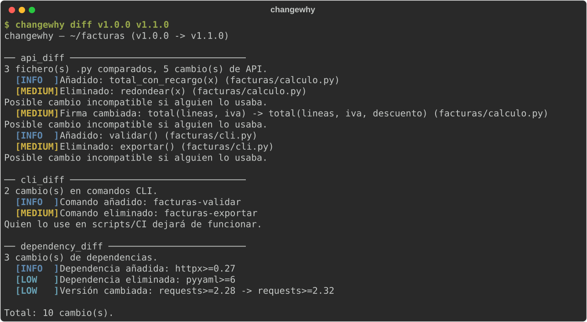

# changewhy

Un changelog real: compara dos versiones de un repo (tags, ramas, commits) y
explica qué cambió de verdad — no solo lee los mensajes de commit, que
pueden mentir, faltar o no reflejar el impacto real.

```
$ changewhy diff v1.2.0 v1.3.0

changewhy — /ruta/al/repo (v1.2.0 -> v1.3.0)

── api_diff ──────────────────────────────
  3 fichero(s) .py comparados, 2 cambio(s) de API.
  [MEDIUM] Eliminado: Client.connect(host, port)
           Posible cambio incompatible si alguien lo usaba.
  [INFO  ] Añadido: Client.connect_async(host, port, timeout=30)

── dependency_diff ───────────────────────
  1 cambio(s) de dependencias.
  [LOW   ] Versión cambiada: requests>=2.28 -> requests>=2.31

Total: 3 cambio(s).
```

## Así se ve



<sub>Ejecución real sobre dos versiones etiquetadas de un proyecto de ejemplo (todos los datos son ficticios).</sub>

## Por qué existe

Los generadores de changelog habituales resumen mensajes de commit — útil,
pero no dice si rompiste la API pública, si cambiaste una dependencia de
forma incompatible, o si quitaste un comando de la CLI. `changewhy` compara
el código y la configuración reales entre dos refs de git, no el texto de
los commits.

## Instalación

Todavía no está en PyPI:

```bash
pip install git+https://github.com/jl-segurayuste/changewhy.git
```

## Uso

```bash
changewhy diff v1.2.0 v1.3.0             # dos tags
changewhy diff main HEAD                  # rama vs. HEAD actual
changewhy diff abc123 def456 ruta/al/repo
changewhy diff v1.2.0 v1.3.0 --json
changewhy diff v1.2.0 v1.3.0 --fail-on medium   # código 1 si hay algo "medium" o peor
                                                  # código 2 si la ref no existe o algún check no se pudo ejecutar
changewhy list-checks
```

## Checks incluidos

| Check | Qué detecta |
|---|---|
| `api_diff` | Funciones/métodos públicos de Python (sin `_` inicial) añadidos, eliminados o con la firma cambiada, vía AST — no regex |
| `dependency_diff` | Dependencias añadidas/eliminadas/con versión cambiada en `requirements.txt`/`pyproject.toml` (incluidos los extras de `optional-dependencies`) |
| `cli_diff` | Comandos de `[project.scripts]` añadidos, eliminados o redirigidos a otro entry point |

Nunca ejecuta el código de ninguno de los dos refs — solo lee su contenido
vía `git show <ref>:<path>` y lo analiza estáticamente. Cada check es un
plugin independiente (`importlib.metadata.entry_points`, grupo
`changewhy.checks`).

## Desarrollo

```bash
pip install -e ".[dev]"
ruff check .
pytest
```
